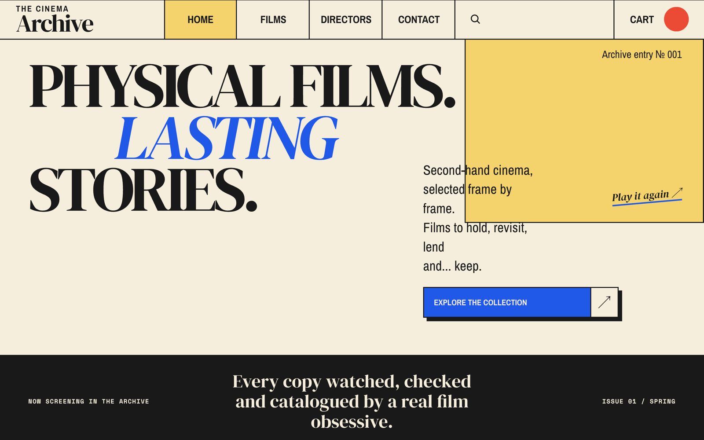
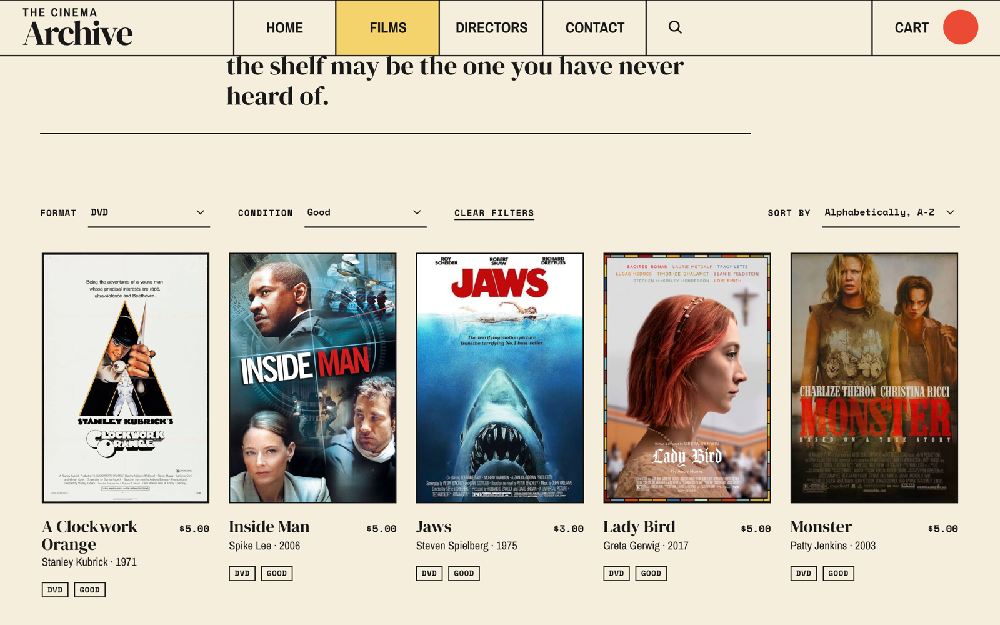
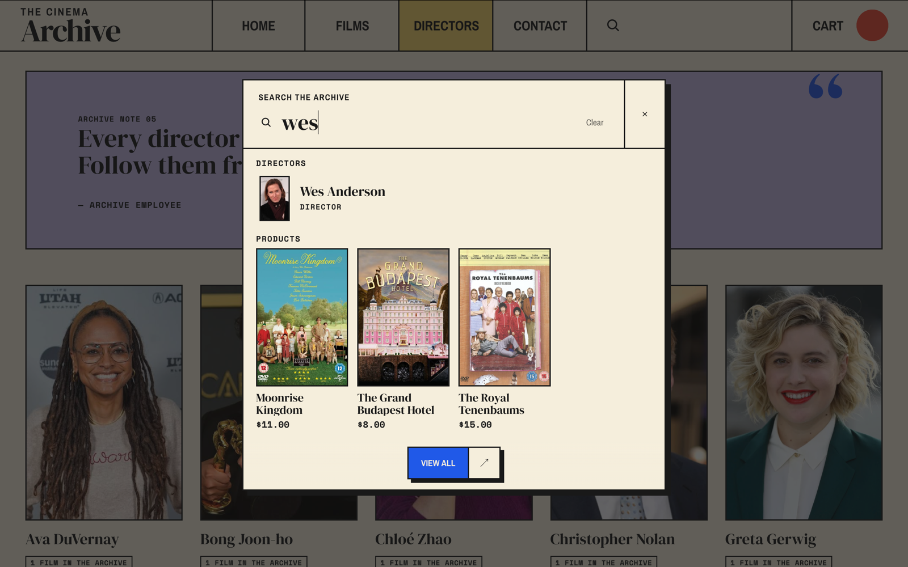

# The Cinema Archive

A second-hand film store built on Shopify. The Cinema Archive sells physical films (DVD and Blu-ray) and puts film discovery and film history first: every copy is a single, inspected item, and every film is connected to its director.

The project is a customised version of Shopify's **Horizon** theme, built as a five-week final project before an internship (LIA). It demonstrates Shopify theme development with Liquid, reusable sections and theme blocks, product metafields and a metaobject for directors.

> **Status:** school project, published on a password-protected Shopify development store. Checkout uses Shopify's test payment gateway; there are no real customers or orders.

---

## Contents

- [Screenshots](#screenshots)
- [Features](#features)
- [Tech stack](#tech-stack)
- [Data model](#data-model)
- [Project structure](#project-structure)
- [Getting started](#getting-started)
- [Store setup (Shopify Admin)](#store-setup-shopify-admin)
- [Working with the Theme Editor](#working-with-the-theme-editor)
- [Git workflow](#git-workflow)
- [Testing](#testing)
- [Known limitations](#known-limitations)
- [Use of AI](#use-of-ai)
- [Credits and license](#credits-and-license)

---

## Screenshots

**Homepage:** the archive introduction and the marquee band.



**Films:** the format and condition filters, with DVD and Good chosen.



**Search:** searching for "wes" shows the director above his films.



---

## Features

**Homepage**
- Archive introduction (hero), a dark marquee band and a quote section with a photo.
- *Featured films*: four films from a hand-picked collection, *The Edit*, with a staggered layout and a "View all N films" button.
- *Director focus*: highlights one director from the Directors metaobject.
- Newsletter sign-up using Shopify's native customer form.

**Films (collection page)**
- Collection hero with an automatic product count.
- Toolbar with *Format* and *Condition* dropdowns and sorting in one form. The filters combine (for example Blu-ray + Very good), choices with no films are disabled, and a "Clear filters" link resets both while keeping the sorting. After each choice the page reloads at the toolbar, not at the top.
- Film cards in fixed columns (2 on mobile, 3 on tablets, 5 on desktop, 6 on wide screens), showing director, release year, format and condition from metafields.

**Search**
- Search modal in the archive style. Typing a director's name ("wes", "tarantino", "chloe") shows the director above the matching films; the arrow keys and Enter work for directors as well as films.
- Search results page with the same toolbar and film cards as the Films page.

**Product page**
- Large title, description, price and an "Only one copy" badge when exactly one copy is in stock.
- Film details: director (linked to the director page), format, release year, runtime and condition.
- An "archive note" quote box per film, and "More from [director] in the archive".
- Restyled buy button and sticky add-to-cart bar.

**Cart**
- Slide-in cart that opens over the page with a dark backdrop on every screen size, and a cart page, both in the archive style.
- No quantity selector, since every film is a single copy; the remove button stays.
- "You may also like" on the cart page leaves out films that are already in the cart and sold-out films.
- Shopify's native checkout.

**Directors**
- Directors overview with portrait cards and the number of films per director.
- Director page with portrait, facts (born, country, films in the archive), lead text, biography and filmography.

**Contact page**
- Styled Shopify contact form and a "sell or donate your films" section.

**Details**
- Call-to-action buttons share one behaviour: the arrow cell turns yellow on hover and keyboard focus, and the button presses down slightly when clicked (switched off for visitors who prefer reduced motion).
- Header with a text logo and a grid menu on desktop; touch screens get Shopify's drawer menu in the archive colours.
- Favicon in the archive style, and arrows that stay text instead of turning into emoji on iPhone.

**Responsive** layouts for mobile, tablet and desktop, tested at 390–440, 1024, 1280, 1440, 1920 and 2560 px, on a real iPhone and on the school projector (1920 × 1080).

## Tech stack

- Shopify development store and **Horizon 4.2.0** theme
- Shopify Liquid, HTML, CSS and a little JavaScript (Horizon's own components)
- Product metafields and a Directors metaobject
- Shopify Search & Discovery app (storefront filters for format and condition)
- Shopify CLI for local development
- Git and GitHub

Shopify handles products, inventory, cart, checkout and hosting. There is no custom backend or database.

## Data model

### Product metafields (namespace `custom`)

| Key | Type | Used for |
|---|---|---|
| `format` | Single line text | "DVD" or "BLU-RAY". Also a storefront filter. |
| `condition` | Single line text | "Mint", "Very good", "Good" or "Used". Also a storefront filter. |
| `release_year` | Integer | e.g. 2003 |
| `runtime` | Integer (minutes) | shown as "1 h 42 min" |
| `director` | Metaobject reference (Directors) | links a film to its director |
| `archive_note` | Multi-line text | quote in the product page's archive note box |
| `archive_note_author` | Single line text | e.g. "Archive employee" |

`format` and `condition` are free text, so the values must be spelled exactly as above. A new spelling (for example "Bluray") would show up as an extra choice in the filter.

**Product tag:** every film also has a tag with the director's full name, for example `Wes Anderson`. Shopify's search reads tags but not metaobject references, so the tag is what makes "wes" find the films.

### Directors metaobject (type `directors`)

| Field | Type |
|---|---|
| `name` | Single line text |
| `portrait` | Image |
| `biography` | Rich text |
| `lead` | Multi-line text (optional) |
| `born` | Integer (optional) |
| `country` | Single line text (optional) |

The metaobject has web pages enabled, so each director gets a page at `/pages/directors/<handle>` (template `templates/metaobject/directors.json`).

**Search suggestions:** Shopify's predictive search cannot return metaobjects, so `snippets/predictive-search-directors.liquid` matches the search against the directors in Liquid. A director matches when a word in the name starts with the search; the handle is checked too, so "chloe" finds Chloé Zhao.

**Filmography:** Liquid cannot look up "all products with this director" directly, so the theme scans the first 50 products of `collections.all` and keeps those whose director matches. This is fine for a small, curated catalogue.

Empty or missing values are hidden everywhere, so a film without a runtime or a director without a portrait still renders cleanly.

## Project structure

The theme follows the standard Shopify theme layout. Files added for this project:

```
sections/
  archive-introduction.liquid   homepage hero
  archive-marquee.liquid        dark quote band
  featured-films.liquid         homepage film selection
  archive-quote.liquid          photo + quote section
  director-focus.liquid         one highlighted director
  archive-newsletter.liquid     newsletter band (Horizon email-signup block)
  collection-hero.liquid        Films page hero
  collection-toolbar.liquid     format and condition dropdowns, sorting, "Clear filters"
  archive-note.liquid           short editorial quote between two rules
  archive-back-link.liquid      "← Back to archive" on the product page
  product-archive-note.liquid   per-film quote box
  product-director-films.liquid "More from [director]"
  main-directors.liquid         directors overview
  main-director.liquid          director filmography
  director-hero.liquid          director page hero
  director-portrait.liquid      director lead text and biography
  contact-archive.liquid        contact page
  cart-recommendations.liquid   "You may also like" on the cart page
  archive-footer.liquid         footer

blocks/
  film-title.liquid             product title and description
  film-price.liquid             price and "Only one copy" badge
  film-details.liquid           wrapper for snippets/film-details.liquid
  film-buy-note.liquid          note under the buy button, buy button styles

snippets/
  film-card.liquid              reusable film card
  film-card-meta.liquid         card text on the Films page (Horizon cards)
  film-details.liquid           director/format/year/runtime/condition list
  quote-box.liquid              coloured quote box
  archive-note.liquid           quote between two rules
  predictive-search-directors.liquid  directors in the search suggestions
  archive-search-styles.liquid  styles for the search modal and the search page
  archive-cart-styles.liquid    styles for the slide-in cart and the cart page

templates/
  page.directors.json           directors overview page
  metaobject/directors.json     director page
```

### Changes to Horizon files

Most of the work is in new files, but a few of Horizon's own files had to change. The changes are small; where the reason is not obvious from the code, a comment explains it.

| File | Change |
|---|---|
| `sections/header.liquid` | Header layout and colours. The desktop layout applies only in Horizon's menu mode, so touch screens get the drawer menu instead of a broken mix. In drawer mode one of Horizon's two search icons is hidden, since with customer accounts off Horizon shows both. |
| `blocks/_header-logo.liquid` | Text logo instead of an image |
| `blocks/_header-menu.liquid` | Active state for menu links with a query string |
| `snippets/search-modal.liquid` | Visible "Search the archive" label and the archive search styles |
| `sections/predictive-search.liquid` | Directors above the films in the search suggestions |
| `snippets/cart-drawer.liquid` | Loads the archive cart styles |
| `assets/theme-drawer.js` and `snippets/theme-drawer.liquid` | The slide-in cart opens over the page on every screen size, instead of squeezing the page on wide screens |
| `locales/en.default.json` | Button text "Add this copy to cart" and the search placeholder |

A future update of Horizon could overwrite these files, so they need to be checked again after an update.

## Getting started

### Prerequisites

- A Shopify store (a development store from the Shopify Partner Dashboard works)
- [Shopify CLI](https://shopify.dev/docs/storefronts/themes/tools/cli)
- Git and Node.js (required by Shopify CLI)

### Run the theme locally

```sh
git clone https://github.com/EddieJohanssonn3000/The-Cinema-Archive.git
cd The-Cinema-Archive
shopify theme dev --store <your-store>.myshopify.com --theme-editor-sync
```

Open `http://127.0.0.1:9292`. If the store is password protected, enter the store password once. `--theme-editor-sync` writes changes made in the Theme Editor back to your local JSON files.

The theme only looks right once the store has the metafields, the Directors metaobject and some content (see below).

### First publish

Push to a new, unpublished theme first, preview it in the store, then publish it from Online Store → Themes:

```sh
shopify theme push --unpublished --store <your-store>.myshopify.com
```

The previous live theme stays in the theme library, so publishing can be undone with one click.

### Update the live theme

After a feature is merged into `dev` (see [Git workflow](#git-workflow)):

1. Stop `shopify theme dev`, switch to `dev` and pull.
2. Check `git status` and compare the live theme's templates with the local ones, so no settings in the store are overwritten by mistake.
3. Push to the live theme:

```sh
shopify theme push --theme <live-theme-id> --store <your-store>.myshopify.com --allow-live
```

`--allow-live` confirms on purpose that the published theme is changed. Never change the live theme with *Edit theme* in Admin: those changes are not in Git and are overwritten by the next push. Make Theme Editor changes through the link that `shopify theme dev` prints instead.

## Store setup (Shopify Admin)

These parts live in the store, not in this repository:

1. **Product metafield definitions** (Settings → Metafields and metaobjects → Products) with the keys and types listed in [Data model](#data-model).
2. **Directors metaobject definition** with the fields above, with web pages (online store) enabled.
3. **Search & Discovery app** → Filters → add filters for the product metafields *Format* and *Condition*. Their order there is the order of the dropdowns; sort the condition values manually (Mint, Very good, Good, Used).
4. **Pages:** a page *Directors* using the template `page.directors`, and a *Contact* page. The template can only be chosen in Admin once the theme is published.
5. **Main menu:** Home, Films (`/collections/all`), Directors (the Directors page) and Contact.
6. **Products:** one product per physical copy, inventory tracked with quantity 1, metafields filled in, and a tag with the director's full name.
7. **Collection *The Edit*:** a manual collection with the films for the homepage, chosen in the *Featured films* section.
8. **Customer accounts:** sign-in links turned off (Settings → Customer accounts), since the store has no accounts.
9. **Payments:** Shopify's test payment gateway for test orders. Set inventory back to 1 after a test order.
10. **Sender email** (Settings → Notifications) for messages from the contact form.
11. **Password protection** (Online Store → Preferences). Share the password with people who should see the store.

Discount codes are switched off in the theme settings (Theme settings → Cart), so that setting lives in `config/settings_data.json`, not in Admin.

## Working with the Theme Editor

Section settings and the order of sections are stored in JSON files in `templates/` and `sections/*-group.json`.

- Check `git status` after saving in the Theme Editor. If a template you changed is not listed, pull it from the store before committing.
- Stop `shopify theme dev` before switching Git branches or merging. Otherwise the CLI can upload files mid-switch and overwrite settings in the store.
- If the CLI asks whether to keep the local or remote version, compare first; the local version (from Git) is usually the right one.

## Git workflow

- `main`: stable, tested code; updated from `dev` at the code freeze before the presentation
- `dev`: finished features; this is what runs on the live theme
- `feature/<name>`, `fix/<name>`, `docs/<name>`: one branch per topic, created from `dev`

Every change reaches `dev` through a pull request on GitHub, never by committing to `dev` directly. Inside a branch, each working step is its own commit with a short message, for example "Keep the sorting when filtering". After a merge, `dev` is pushed to the live theme (see [Update the live theme](#update-the-live-theme)).

Changes made in the Theme Editor are saved into JSON files in the repository, so they are made on a branch too.

## Testing

Checked for each feature before it was merged:

- **Screen widths** 390–440, 768, 1024, 1280, 1440, 1920 and 2560 px (Chrome DevTools, device type *Desktop* for desktop sizes, since the *Mobile* type turns on touch and changes Horizon's header)
- **Real devices:** an iPhone, through the theme preview link, and the school projector at 1920 × 1080
- **Empty and missing data:** no director, no runtime, no portrait, no archive note, an empty cart, a search with no results
- **Shopping:** cart, checkout with test payments, sold-out products, the contact form and the newsletter form
- **Filters and search:** every combination of format and condition, sorting, "Clear filters", and search terms with quotes and apostrophes, clicked through in a headless Chrome
- **Keyboard:** Tab and the arrow keys through the toolbar and the search suggestions, with a visible focus indicator
- **Security:** search terms, filter values and sort values containing HTML and script tags, checked to make sure nothing is output unescaped
- **Lighthouse:** Accessibility 100 on the Films page and 95 on the homepage
- `shopify theme check` (no errors)

## Known limitations

**Data**
- The director is stored twice: as a metaobject reference (for the director pages) and as a product tag (for search). Both must be filled in for every film.
- `format` and `condition` are free text, so a new spelling becomes an extra choice in the filter.
- Filmographies and "More from…" scan the first 50 products only.

**Search and filters**
- Director suggestions appear in the search modal only, not on the search results page. A director matches when a word in the name starts with the search, and at most three are shown.
- Screen readers hear the number of matching films in the search modal; directors are not included in that number, but are read out when reached with the arrow keys.
- Shopify's search index updates a few minutes after a product is saved, so new films and changed values can take a moment to appear in search and filters.
- When "All" is chosen in a filter dropdown, the address still contains the empty filter (for example `filter.p.m.custom.format=`). Shopify ignores it.
- In Chrome, a dropdown shows its focus outline after a mouse click too, not only with the keyboard.
- Films cannot be sorted by release year. Shopify's built-in sorting cannot use metafields, so it would need an app or an external API. "Newest arrivals" sorts by when a film was added to the store, and "Featured", "Most relevant", "Best selling" and oldest-first are hidden from the dropdown.
- A sold-out film (inventory 0) can no longer be bought, but it still appears on Films, in search and on its director's page. Hiding it would mean an automated collection with the condition "Inventory stock is greater than 0" for Films; search and the director pages would still need their own solution.

**Layout**
- On touch devices with wide screens (e.g. iPad) Horizon switches the header to its drawer menu.
- The Directors overview and the search page keep Horizon's page width, so very wide screens show empty space at the sides.
- Removing a film on the cart page does not refresh "You may also like" until the page is reloaded.

**Theme**
- Nine Horizon files are changed (see [Changes to Horizon files](#changes-to-horizon-files)); an update of Horizon could overwrite them.
- Horizon renders the heading id `cart-drawer-heading` twice on every page.

## Use of AI

AI tools were used as a pair programmer and tutor during the project.

**Tools**
- **Claude Code** (Anthropic), in VS Code, for most of the development work
- **GitHub Copilot**

**What AI was used for**
- Recommending, writing and refactoring Liquid, CSS and section schemas based on my descriptions and the Figma design
- Explaining Liquid, Shopify concepts (metafields, metaobjects, theme blocks, storefront filters) and the reasoning behind each change, so I could understand and maintain the code
- Reading Horizon's existing code before changes, so custom code reuses Horizon's patterns instead of rewriting them
- Reviewing diffs before commits, and finding risks and bugs (for example a whitespace bug in the runtime and an HTML-escaping bug in a heading)
- Troubleshooting Shopify CLI and Theme Editor sync problems
- Testing: In general. 
- Checking the product data (metafields, tags, prices, director links) and comparing the live theme with `dev` before each push

**What I did myself**
- Coding, the concept, the visual design in Figma and all design decisions
- Setting up the store in Shopify Admin: metafield and metaobject definitions, products, directors, collections, pages, menus and the Search & Discovery filters
- Choosing between the options AI proposed, and deciding what to build and what to leave out
- Testing on my own iPhone and on the school projector, and approving every change before it was merged and published
- Git: committing, branching, pull requests, merging and pushing to the live theme

**How I worked with AI**
- One small step at a time: the AI explained the plan and the files involved before changing anything, and asked for my approval before changes.
- Every change was checked in the browser and with `shopify theme check` before it was committed.
- Facts in the store content (years, runtimes, biographies) are my responsibility to verify, since AI can get them wrong.

## Credits and license

- Based on [Horizon](https://github.com/Shopify/horizon) by Shopify. Horizon's license is in [LICENSE.md](LICENSE.md). It restricts how themes derived from Horizon may be distributed, so this repository is not intended for public distribution or reuse as a theme product.
- Photo in the homepage quote section: Jeremy Yap / Unsplash.
- Film posters and director portraits belong to their respective rights holders and are used for educational purposes only.


- Built by Eddie Johansson.
